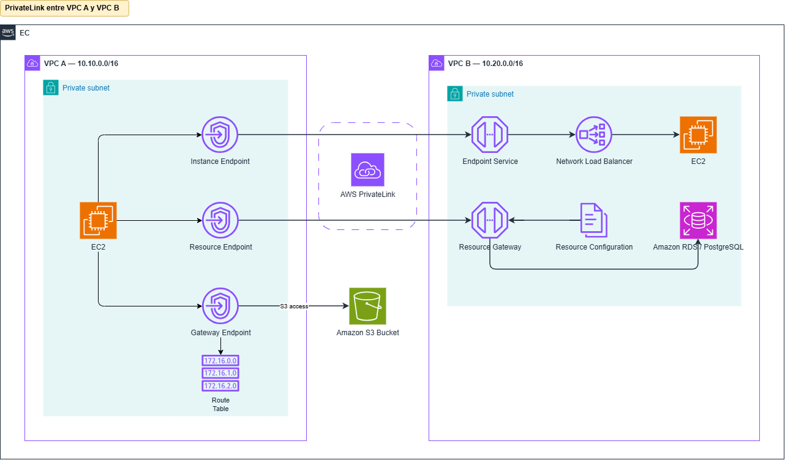

# AWS: Private Communication Between Two VPCs Using VPC Endpoints and AWS PrivateLink

# Overview

This project demonstrates how to establish secure, private communication between two independent Amazon Virtual Private Clouds (VPCs) using three different AWS connectivity mechanisms: Interface Endpoints, Resource Endpoints, and Gateway Endpoints.

The scenario simulates a distributed application architecture where an application running in VPC A needs to access resources hosted in VPC B, including an EC2 instance, an Amazon RDS database, and an Amazon S3 bucket.

Rather than relying on public internet connectivity, VPC peering, or traditional network routing, this project explores how AWS PrivateLink and VPC Endpoints enable private and controlled access to services and resources across VPC boundaries.

The main objective is to implement and validate all three connectivity approaches, understand their architectural differences, and demonstrate when each mechanism is appropriate depending on the type of resource being accessed.

---

## How to Navigate the Project

If you are reviewing this project for the first time, the recommended order is:

1. **Overview**
   Understand the scenario presented.

1. **Project Structure**
    Shows how the files and documents are structured.

1. **Business requirement**
    Business use case explaining the situation.

1. **Architecture**
   Review the architecture proposal, goals and the diagrams.

1. **Infrastructure as a Code**
   Follow the instructions to reproduce the environments using AWS CloudFormation o Terraform scripts.


---

## Project Structure

```text
.
├── cloudformation/
│   ├── basescenario/
│   │    ├── ec2.yaml
│   │    ├── main.yaml
│   │    └── vpc.yaml
│   ├── privatelink/
│   └── README.md
│
├── terraform/
│   ├── main.tf
│   ├── variables.tf
│   ├── outputs.tf
│   ├── providers.tf
│   └── README.md
│
├── DBScripts.txt
├── tests.md
├── PrivateLink.drawio.png
└── README.md
```

---

# Business requirement

A company has two independent environments in AWS:
- VPC A – Application Network: hosts an API that processes client requests.
- VPC B – Data Services Network: centralizes internal services, a database, and file storage.

The API deployed in VPC A needs to access three private resources in VPC B:

1. An EC2 server running an internal service.
2. An RDS database for querying information.
3. An S3 bucket for storing files generated by the application.

The company wants to keep both environments isolated and allow only the necessary connections.


---

# Architecture

The architecture was intentionally designed to demonstrate three different private connectivity mechanisms within a single scenario.



Each mechanism addresses a specific connectivity requirement:

### 1. Interface Endpoint – PrivateLink for EC2 access

An Interface Endpoint is used to provide private connectivity from VPC A to an application service hosted on an EC2 instance in VPC B.

The service is exposed through AWS PrivateLink, allowing consumers in VPC A to access the provider service through private IP addresses and endpoint network interfaces, without requiring public IP addresses or direct VPC-to-VPC routing.

### 2. Resource Endpoint – PrivateLink for direct resource access

A Resource Endpoint is used to demonstrate private access to a supported resource in VPC B, such as an RDS database.

This approach illustrates how AWS PrivateLink can provide controlled, resource-level connectivity without exposing the resource publicly or establishing general network connectivity between the VPCs.

### 3. Gateway Endpoint – Private S3 connectivity

A Gateway Endpoint is deployed in VPC A to provide private access to Amazon S3.

This demonstrates a different connectivity model: instead of using PrivateLink through network interfaces, Gateway Endpoints use route table entries to direct S3 traffic through the AWS private network.

This design allows the application to upload files to an S3 bucket without requiring an Internet Gateway, NAT Gateway, or public internet access.

### Architecture rationale

The three mechanisms were deliberately selected because they demonstrate different AWS networking models:

Interface Endpoints: Private connectivity to services exposed through AWS PrivateLink.

Resource Endpoints: Private, resource-level access across VPC boundaries.

Gateway Endpoints: Private access to supported AWS services through route tables.

By implementing these approaches in the same project, the exercise highlights their differences in deployment, routing, security controls, and use cases.


---


## Goals of the Project

The project aims to demonstrate practical knowledge of AWS networking, private connectivity, and cloud security.

The following goals were achieved:

* Designed and implemented two independent VPCs with isolated network environments.
* Established private communication between VPCs using AWS PrivateLink.
* Implemented an Interface Endpoint to access an EC2-hosted service privately.
* Configured a Resource Endpoint to demonstrate resource-level access to a supported database resource.
* Deployed a Gateway Endpoint to enable private communication with Amazon S3.
* Configured endpoint policies, security groups, and network access controls to restrict communication.
* Evaluated the differences between Interface, Resource, and Gateway Endpoints.
* Demonstrated how applications can consume services across VPC boundaries without requiring public internet exposure.
* Applied AWS networking and security principles through Infrastructure as Code.


| Technology | Purpose |
|---|---|
| Amazon VPC | Isolated network environments for the provider and consumer architectures. |
| Amazon EC2 | Hosts the application service exposed through PrivateLink. |
| Amazon RDS | Database resource used to demonstrate private resource connectivity. |
| Amazon S3 | Object storage accessed through a Gateway Endpoint. |
| AWS PrivateLink | Enables private connectivity between VPCs without exposing services to the public internet. |
| Interface VPC Endpoints | Provide private connectivity through endpoint network interfaces. |
| Resource VPC Endpoints | Enable private access to supported resources across VPC boundaries. |
| Gateway VPC Endpoints | Provide private S3 connectivity through route tables. |
| Security Groups | Control inbound and outbound network traffic. |
| VPC Endpoint Policies | Restrict access to supported services and resources. |
| AWS CloudFormation | Infrastructure as Code to provision and manage the architecture. |


At the end of this project, the architecture demonstrates three distinct ways to establish private connectivity in AWS, providing a practical understanding of how to select the appropriate endpoint type based on application requirements.

This exercise reinforces the ability to design secure, scalable, and isolated cloud architectures while minimizing unnecessary network exposure and operational complexity.

---

# Infrastructure as a Code

Go to the CloudFormation or Terraform folder and follow the instructions to set up the scenario and create the infrastructure required to solve the case.
